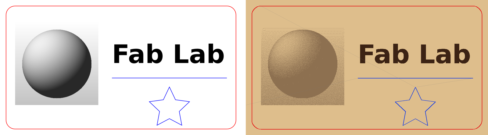
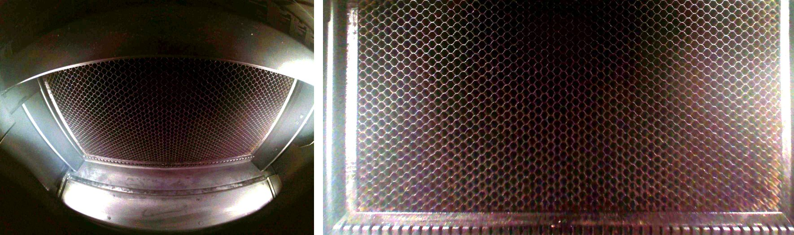
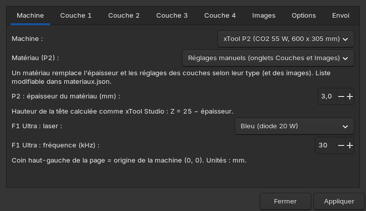
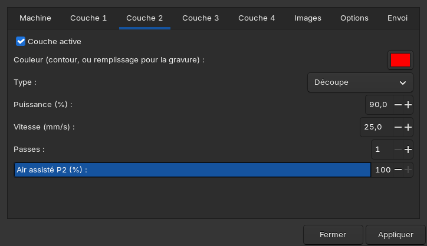
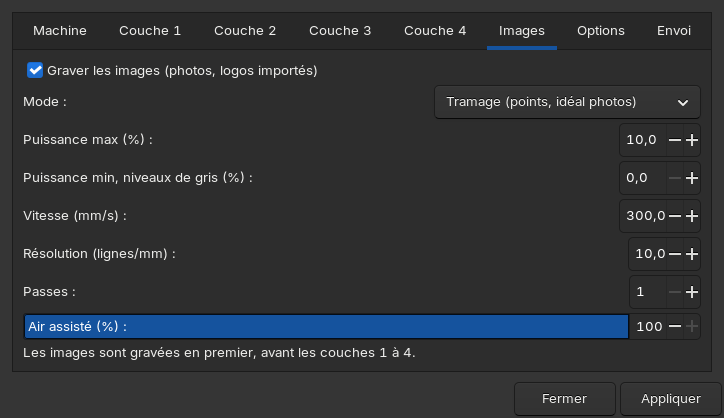
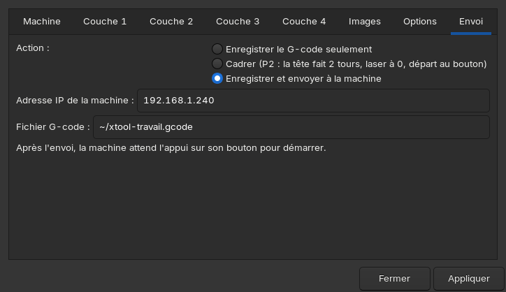

# inkscape-laser-xtool

**Piloter les lasers xTool P2 et F1 Ultra depuis Linux, directement dans Inkscape.**

xTool Studio, le logiciel officiel, n'existe pas pour Linux. Ce projet,
développé au fablab **le Boc@l** (centre social de Chemillé), ajoute à
Inkscape un menu **Extensions > Laser xTool**. Il permet de dessiner, régler,
cadrer et envoyer un travail à la machine par le réseau, sans autre logiciel.

> ⚠️ Projet **non officiel**, sans lien avec xTool. Le protocole a été relevé
> en étudiant xTool Studio 1.9.14 et de vrais travaux envoyés par ce logiciel.
> Un laser est dangereux : restez près de la machine, ne la laissez jamais
> travailler seule, et faites vos essais à faible puissance sur du carton.
> **La machine ne démarre jamais seule** : après chaque envoi, elle attend
> l'appui sur son bouton.

## Ce que ça fait



*À gauche, le dessin dans Inkscape. À droite, la simulation du G-code
produit par l'extension : image en tramage, texte gravé en remplissage,
marquage bleu, découpe rouge. Le fichier de démonstration est dans
[`exemples/demo.svg`](exemples/demo.svg).*

| Fonction | xTool P2 | F1 Ultra |
|---|---|---|
| Envoi du travail par le réseau, départ au bouton | ✅ testé | ⚠️ non testé (protocole V1 seulement) |
| Marquage et découpe par couleur (4 couches) | ✅ testé | ⚠️ non testé |
| Cadrage (la tête fait le tour du dessin, laser éteint) | ✅ testé | — |
| Photo du plateau par la caméra, redressée et à l'échelle | ✅ testé | — |
| Hauteur de tête selon l'épaisseur du matériau | ✅ | — |
| Air assisté par couche | ✅ | — |
| Gravure d'images : tramage, niveaux de gris, noir et blanc | 🧪 à tester sur machine | — |
| Gravure en remplissage des formes et des textes | 🧪 à tester sur machine | — |
| Réglages par matériau (`materiaux.json`) | 🧪 à tester sur machine | — |

## La caméra de la P2



*À gauche, la photo brute de la caméra (objectif grand angle). À droite, la
même photo redressée avec le calibrage enregistré dans la machine. Le menu
**Caméra P2 : photo du plateau** la place en fond de page, à l'échelle
1:1 (600 × 305 mm), dans un calque verrouillé qui n'est jamais gravé. On
place ainsi son dessin exactement sur la pièce posée dans la machine.*

## La fenêtre de l'extension

| Machine et matériau | Couches (couleur → réglages) |
|---|---|
|  |  |
| **Images** | **Envoi** |
|  |  |

## Installation

Il faut Inkscape 1.2 ou plus récent. La version classique et la version
Flatpak fonctionnent toutes les deux.

```
git clone https://github.com/urruck/inkscape-laser-xtool.git
cd inkscape-laser-xtool
bash installer.sh
```

L'installateur crée des liens vers ce dossier dans les extensions
d'Inkscape, sans `sudo`. Relancez ensuite Inkscape. Pour mettre à jour :
`git pull`, puis à nouveau `bash installer.sh`.

L'ordinateur et la machine doivent être sur le même réseau. L'adresse IP de
la machine s'affiche sur son écran ou dans votre box ; on peut la vérifier
avec :

```
python3 xtool.py sonder 192.168.1.240
```

## Utilisation

1. **(P2) Extensions > Laser xTool > Caméra P2 : photo du plateau.** La page
   passe à 600 × 305 mm et la photo du plateau se place en fond.
2. **Dessinez** par-dessus. Le **coin haut-gauche de la page** correspond à
   l'origine (0, 0) de la machine. Unités : mm.
3. Donnez une **couleur par opération**. Par défaut :
   - bleu = marquage (ligne) ;
   - rouge = découpe ;
   - noir = gravure en remplissage (couche 3, à activer) ;
   - vert = seconde découpe.

   Les images importées (photos, logos) sont gravées depuis l'onglet *Images*.
4. **Extensions > Laser xTool > Envoyer vers laser xTool** :
   - onglet *Machine* : la machine, le **matériau** ou les réglages
     manuels, et l'**épaisseur**. Sur la P2, la hauteur de tête est
     Z = 25 − épaisseur, comme dans xTool Studio ;
   - onglets *Couche 1 à 4* : couleur, type (marquage, découpe ou gravure),
     puissance %, vitesse mm/s, passes, air assisté % ;
   - onglet *Images* : tramage, niveaux de gris ou noir et blanc, et
     résolution en lignes/mm ;
   - onglet *Envoi* : **Cadrer** pour vérifier l'emplacement, puis
     **Envoyer**. Appuyez ensuite sur le bouton de la machine.

Ordre de travail : les images, puis les couches 1 → 4. **Mettez la découpe
en dernier**, pour que la pièce ne bouge pas avant la fin de la gravure.

Les textes à marquer ou à découper doivent être convertis : **Chemin > Objet
en chemin**. En gravure de remplissage, les textes sont gravés tels quels.

## Matériaux

Les réglages sont dans [`materiaux.json`](materiaux.json). Chaque matériau
contient :
- `nom` ;
- `source` : d'où vient le réglage ;
- `epaisseur` ;
- un réglage par type : `marquage`, `decoupe`, `gravure`, `image`. Chaque
  réglage indique la puissance, la vitesse, les passes et l'air, plus la
  résolution pour `gravure` et `image`.

```json
{
  "nom": "Contreplaqué tilleul 3 mm",
  "source": "réglage officiel xTool relevé dans un travail P2",
  "epaisseur": 3,
  "decoupe": {"puissance": 90, "vitesse": 25, "passes": 1, "air": 100},
  "image": {"puissance": 10, "vitesse": 300, "resolution": 12, "air": 100}
}
```

Après une modification, relancez `bash installer.sh` puis Inkscape : la
liste des matériaux est intégrée à la fenêtre de l'extension. Si une couche
utilisée n'a pas de réglage pour le matériau choisi, l'envoi est **refusé**.
On ne part ainsi jamais avec un réglage manuel oublié.

N'hésitez pas à proposer vos réglages validés, en indiquant leur source.

## En ligne de commande

```
python3 xtool.py sonder  192.168.1.240                 # état de la machine
python3 xtool.py cadrer  192.168.1.240 10 10 60 40     # tête aux 4 coins x1 y1 x2 y2 (mm), tout de suite
python3 xtool.py photo   192.168.1.240 plateau.jpg     # photo redressée
python3 xtool.py envoyer 192.168.1.240 travail.gcode   # envoi d'un G-code
```

## Fichiers

| Fichier | Rôle |
|---|---|
| `xtool_laser.py` | extension « Envoyer vers laser xTool » : lit le dessin, applique les réglages, produit et envoie le G-code |
| `xtool_camera.py` / `.inx` | extension « Caméra P2 » |
| `xtool_common.py` | G-code P2 / F1 Ultra, réseau, tête, caméra et redressement |
| `xtool_raster.py` | gravure par balayage : tramage, niveaux de gris, dépassement en bout de ligne |
| `generer_inx.py` | génère `xtool_laser.inx` (la fenêtre) à partir de `materiaux.json` |
| `materiaux.json` | réglages par matériau |
| `xtool.py` | outil en ligne de commande |
| `installer.sh` | installation dans Inkscape (classique et Flatpak) |
| `PROTOCOLE.md` | notes techniques sur le protocole des machines |

## Limites actuelles

- La gravure se fait par balayage horizontal seulement, sans hachures
  croisées.
- L'épaisseur se saisit à la main : pas de mesure automatique.
- Le calibrage de la caméra est fait pour 3 mm d'épaisseur. Un léger
  décalage est possible avec des matériaux plus épais.
- La tête ne descend pas entre les passes de découpe.
- F1 Ultra : seul l'envoi est disponible, par le protocole V1, sans
  cadrage ni caméra. Le protocole V2 n'est pas encore décodé.

Les retours d'essai sont les bienvenus. Ouvrez une *issue* en indiquant la
machine, le matériau, les réglages et le résultat.
