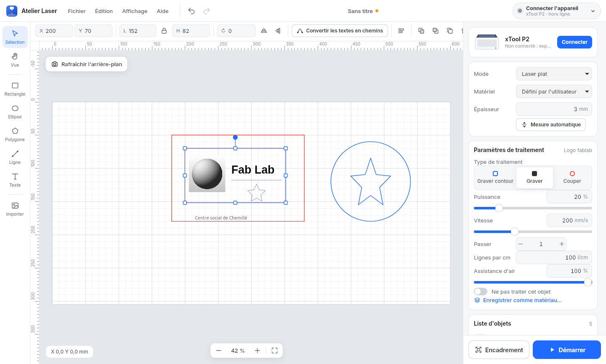

# Atelier Laser

**Un logiciel autonome pour les lasers xTool P2 et F1 Ultra sous Linux, avec
une interface proche de xTool Studio.**

Il réutilise le code de l'extension Inkscape (`xtool_common.py`,
`xtool_raster.py`, `materiaux.json`). Les réglages des matériaux sont donc
communs aux deux outils.



## Installation

**Avec le paquet `.deb`** (Ubuntu 24.04, Zorin OS 18, Linux Mint 22,
Debian 13 et distributions proches) :

```
bash studio/construire_deb.sh
sudo apt install ./dist/atelier-laser_0.1.0_all.deb
```

`apt` installe aussi les dépendances manquantes. Pour désinstaller :
`sudo apt remove atelier-laser`. Le paquet ne contient que des fichiers
Python et web : le même `.deb` sert sur tous les PC (`all`).

**Sans droits administrateur**, pour l'utilisateur courant seulement :

```
bash studio/installer.sh
```

Dans les deux cas, Atelier Laser apparaît dans le menu des applications.
On peut aussi le lancer avec la commande `atelier-laser`.

Il faut Python 3, numpy, Pillow, GTK 4 et WebKitGTK 6. Ces paquets sont
déjà présents sur Ubuntu 24.04, Zorin OS 18 et les distributions proches.
`installer.sh` indique ceux qui manquent. Sans WebKit, l'interface s'ouvre
dans le navigateur (`atelier_laser.py --navigateur`).

## Ce qu'on retrouve de xTool Studio

| Zone | Contenu |
|---|---|
| En haut | menus Fichier, Édition, Affichage, Aide ; annuler et rétablir ; **Connecter l'appareil** et l'état de la machine |
| À gauche | outils : sélection, rectangle, ellipse, polygone ou étoile, ligne, texte, import |
| Barre des propriétés | X, Y, largeur, hauteur, proportions, rotation, miroir, police, alignement, ordre, dupliquer, supprimer |
| Canevas | plateau à l'échelle, règles en mm, grille, **Rafraîchir l'arrière-plan** (caméra P2), zoom |
| À droite | appareil, mode **Laser plat**, **Matériel**, **Épaisseur** et **Mesure automatique** ; **Paramètres de traitement** de l'objet sélectionné ; **Liste d'objets** |
| En bas à droite | **Encadrement** et **Démarrer** |

Comme dans xTool Studio, chaque objet a son propre **type de traitement** :

- **Graver contour** : marquage en suivant le trait ;
- **Graver** : remplissage par balayage, pour les formes, les textes et les
  images (nuances de gris, tramage, noir et blanc) ;
- **Couper**.

Chaque objet a aussi sa puissance, sa vitesse, ses passes, son assistance
d'air et, pour la gravure, ses lignes par cm. L'ordre de travail est
toujours le même : gravures, puis contours, puis découpes.

**Démarrer** ouvre l'**aperçu du traitement** : trajets, durée estimée,
zone et réglages. On envoie ensuite le travail à la machine, ou on exporte
le G-code. La machine attend toujours l'appui sur son bouton.

## Utilisation

1. **Connecter l'appareil** : *Rechercher sur le réseau*, ou saisir
   l'adresse IP. *Travailler sans machine* permet de préparer un projet et
   d'exporter le G-code.
2. Choisir le **matériau**. Il règle l'épaisseur et les paramètres des
   objets.
3. Dessiner, ou **importer** un SVG ou une image. On peut aussi glisser les
   fichiers sur le canevas. Un SVG en mm qui tient dans le plateau garde sa
   position : un dessin fait dans Inkscape sur une page de 600 × 305 mm
   tombe donc au même endroit.
4. Sélectionner chaque objet et choisir son traitement et ses réglages.
5. **Rafraîchir l'arrière-plan** (P2) pour placer le dessin sur la photo du
   plateau.
6. **Encadrement**, puis **Démarrer**.

Un réglage validé peut être ajouté à la liste avec **Enregistrer comme
matériau…**. Il est écrit dans `materiaux.json`. Avec le paquet `.deb`,
ce fichier est copié dans `~/.config/atelier-laser/` au premier
enregistrement.

### Mesure de la hauteur (P2)

**Mesure automatique**, sous **Épaisseur**, mesure le matériau avec le
capteur infrarouge de la tête. Le point mesuré est le centre de la
sélection, ou le centre du plateau si rien n'est sélectionné. La tête s'y
déplace laser éteint, puis revient à l'origine. L'épaisseur trouvée règle
la hauteur de travail (Z = 25 − épaisseur).

Cette fonction n'a pas encore été essayée sur la machine. Chaque mesure est
notée dans `~/.config/atelier-laser/mesures.log`, avec la réponse brute de
la P2. En cas d'échec, cette réponse est aussi affichée : elle sert à
corriger la fonction.

Les projets sont enregistrés dans des fichiers `.alaser` (JSON). Une
sauvegarde de secours est faite toutes les 20 secondes. Elle est proposée
au lancement suivant si le projet n'a pas été enregistré.

Les textes à marquer ou à couper doivent d'abord être convertis avec
**Convertir en chemin**. Cette fonction appelle Inkscape, en version
classique ou Flatpak.

## Limites

Ce sont les mêmes que l'extension (voir le [README](../README.md)) :

- la gravure ne fonctionne que sur la P2 ;
- l'encadrement et la caméra ne fonctionnent que sur la P2 ;
- la mesure automatique de l'épaisseur n'a pas encore été testée sur la
  machine.

S'y ajoutent les limites propres à Atelier Laser :

- pas d'édition des nœuds ;
- pas d'opérations booléennes ;
- les masques et les découpes (`clipPath`) des SVG importés ne sont pas
  pris en compte.

## Fichiers

| Fichier | Rôle |
|---|---|
| `atelier_laser.py` | fenêtre GTK/WebKit et serveur local : G-code, envoi, caméra, recherche des machines, fichiers |
| `web/index.html`, `web/style.css` | interface |
| `web/app.js` | canevas, outils, réglages, préparation du travail (tracés et images de gravure) |
| `web/geometrie.js` | lecture des chemins SVG et aplatissement des courbes |
| `web/icones.js` | icônes |
| `installer.sh` | installation sans droits administrateur : raccourci dans le menu et commande `atelier-laser` |
| `construire_deb.sh` | construit le paquet `dist/atelier-laser_VERSION_all.deb` |
